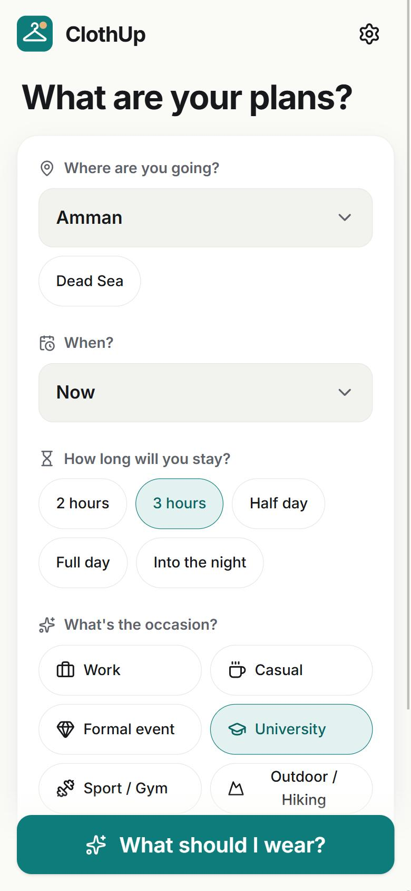
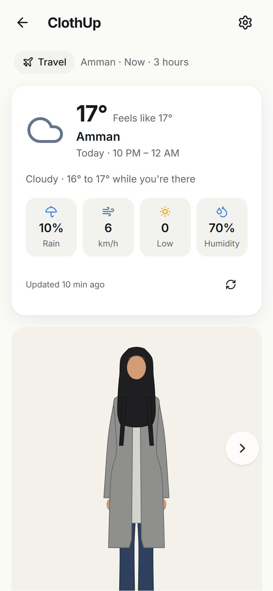
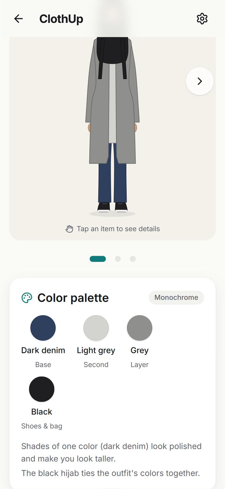
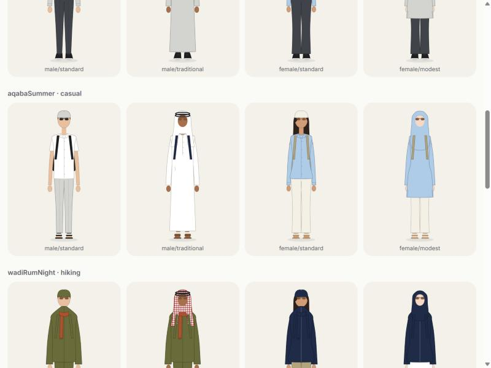

# ClothUp · لبسني

**What to wear today in Jordan, based on the weather.**

ClothUp asks where you're going, when, and for what occasion, checks the forecast for that place, and suggests a complete head-to-toe outfit drawn on an illustrated character, with a harmonious color palette and a short reason for every piece.

- 74 places across all 12 governorates (cities, Amman neighbourhoods, tourist sites, universities, the airport) or your current location
- Weather over your whole stay, up to 16 days ahead: feels-like in the sun and in the shade, day/night swing, rain, wind and its direction, UV, dust/sandstorms, sharqiya, fog, snow; typical weather for later dates
- Occasions: work, casual, formal, university, gym, hiking, religious visit, wedding/party, travel
- Styles: men (standard, traditional with thobe, shemagh and bisht), women (standard, modest / hijab-friendly)
- Up to three outfit options; change any single item and the rest stays put; it learns what you like
- Optional height, weight, age and "I feel the cold / heat" to tailor the character and the suggestions (stored on the device only)
- My closet: suggest only the clothes you own; save and share outfits
- Trip planner: an outfit for each day of a trip and one packing list; morning reminder with the day's outfit (Android)
- Fabric suggestions with a one-line reason, and color palettes from color theory shown as named swatches
- Smart styling: colors that flatter your skin tone, proportions that suit your height and build, and a Classic, Modern or Minimal look
- Tap any item on the character to see its color, fabric and why it was chosen
- Arabic and English with full RTL, light and dark mode, works offline with cached forecasts
- Android and desktop (Windows, macOS, Linux) from one codebase

See [docs/PLAN.md](docs/PLAN.md) for the design and [docs/DATA_GUIDE.md](docs/DATA_GUIDE.md) to add clothes, places and rules.

## Screenshots

| Plan your day | Weather and outfit | Palette |
|---|---|---|
|  |  |  |

The same weather, four styles (Aqaba summer, casual):



## Download

Grab the latest build from [Releases](https://github.com/hkrayt/ClothUp/releases):

| Platform | File |
|---|---|
| Android | `ClothUp-vX.Y.Z-android.apk` (sideload) or `.aab` (Play Store) |
| Windows | `ClothUp_X.Y.Z_x64-setup.exe` or `.msi` |
| macOS | `ClothUp_X.Y.Z_universal.dmg` (unsigned: right-click → Open the first time) |
| Linux | `.AppImage` or `.deb` |

Windows may show a SmartScreen warning because the installer isn't code-signed: choose **More info → Run anyway**.

## Tech stack

| Layer | Choice |
|---|---|
| UI | React 19 + TypeScript, Vite, Tailwind CSS v4 |
| State | Zustand (persisted) |
| i18n | i18next (English, Arabic, RTL) |
| Android | Capacitor 8 |
| Desktop | Tauri 2 (Windows, macOS, Linux) |
| Weather | [Open-Meteo](https://open-meteo.com/) forecast + air-quality APIs (free, no API key) |
| Tests | Vitest |

## Getting started

Prerequisites: **Node.js 22+**. For desktop builds: **Rust** (stable) and the [Tauri prerequisites](https://tauri.app/start/prerequisites/). For Android: **Android Studio** (SDK 36, JDK 21).

```bash
npm install
npm run dev            # web preview at http://localhost:5173
```

### Desktop (Tauri)

```bash
npm run tauri dev      # run the desktop app with hot reload
npm run tauri build    # build installers into src-tauri/target/release/bundle
```

### Android (Capacitor)

```bash
npm run cap:sync       # build the web app and copy it into android/
npm run android:open   # open in Android Studio, then Run ▶
```

Command-line build (needs `JAVA_HOME` pointing to JDK 21):

```bash
cd android && ./gradlew assembleDebug
```

### Checks

```bash
npm run lint
npm run typecheck
npm test
```

## Project structure

```
src/
  app/        app shell, settings, theme and language switching
  features/   screens: questions, weather, outfit, character, settings
  engine/     pure TypeScript outfit + color engines (no UI code)
  data/       editable JSON: places, clothing, rules, colors, palettes
  ui/         design system components
  i18n/       en.json, ar.json
src-tauri/    desktop shell
android/      Android project
docs/         plan, data guide, screenshots, release notes
```

Clothing items, outfit rules and color palettes are plain JSON in `src/data/` — see `docs/DATA_GUIDE.md` (added with the outfit engine) to add your own.

## Releases

Each milestone is developed on a `milestone/N-name` branch, merged into `main`, and tagged `vX.Y.Z`. Pushing a tag runs `.github/workflows/release.yml`, which builds the Android APK/AAB and the desktop installers and attaches them to a GitHub Release with notes generated from the conventional commits.

Bump the version with:

```bash
npm version 0.2.0 --no-git-tag-version
npm run sync-version
```

### Android signing secrets

Release APKs are signed in CI from these repository secrets (without them CI builds a debug APK):

| Secret | Value |
|---|---|
| `ANDROID_KEYSTORE_BASE64` | the `.jks` file, base64-encoded |
| `ANDROID_KEYSTORE_PASSWORD` | keystore password |
| `ANDROID_KEY_ALIAS` | key alias |
| `ANDROID_KEY_PASSWORD` | key password |

The keystore is never committed (`*.jks` is git-ignored).

## Weather data

Weather data by [Open-Meteo.com](https://open-meteo.com/) (CC BY 4.0). Free for non-commercial use.

## Privacy

No accounts, ads or analytics; everything you enter stays on your device. See [PRIVACY.md](PRIVACY.md).

## License

[MIT](LICENSE)
